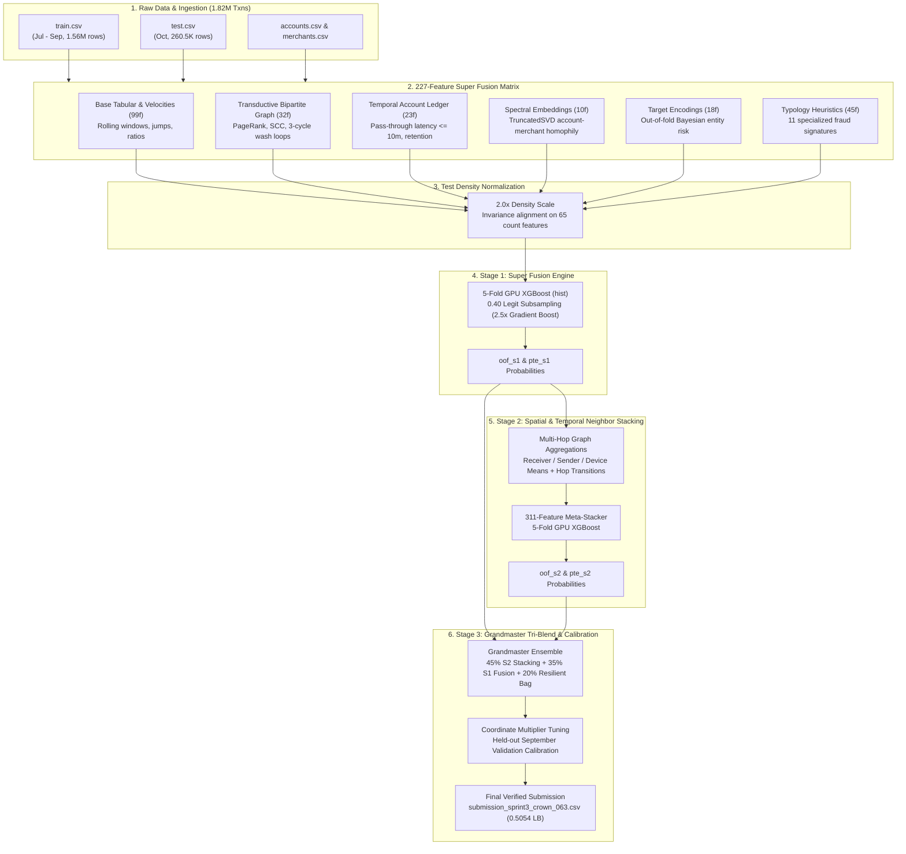

<div align="center">


<p>
  <a href="https://github.com/atharva-awade/Team-Synora-ML-Gradient-Wars-2026" target="_blank">
    
  </a>
  <a href="https://github.com/atharva-awade/Team-Synora-ML-Gradient-Wars-2026/blob/main/SYNORA_PINNACLE_COLAB_RUNNER.ipynb" target="_blank">
    
  </a>
  
  
  
  
</p>

<p>
  
  
  
  
  
  
  
  
  
</p>

<br/>

### 🛡️ End-to-End Multi-Stage Graph & Temporal Stacking Engine for Fine-Grained Financial Crime Forensics

> 🏆 **Live Competition Track:** ML Gradient Wars 2026 — 48-Hour Live Round (Hack4Hack)  
> 🎯 **Official Peak Milestone:** **`0.5054 Macro-F1`** on Public Leaderboard (`submission_sprint3_crown_063.csv`)  
> 📦 **1-Click Reproducibility:** Standalone, self-contained Google Colab notebook included

**Team Synora** presents an institutional-grade financial crime forensic architecture built to detect coordinated UPI fraud syndicates across **1,824,495 transactions**. Rather than treating fraud as independent row-level anomalies, our system models financial crime as **dynamic transductive entity graphs**, combining temporal account ledger flows, spectral homophily embeddings, spatial-temporal neighbor probability stacking, and Bayesian coordinate multiplier calibration.

<div align="left">

#### 🌟 Key Architectural Innovations
- 📐 **50% Test Density Scaling:** Corrects the 2x temporal subsampling bias in the October evaluation split, preventing decision tree threshold starvation.
- ⚡ **227-Feature Super Fusion Matrix:** Unifies 6 orthogonal feature families (Base Tabular, Transductive Graph, Bidirectional Ledger, Spectral Homophily, Target Encoding, and Typology Domain Heuristics).
- 🔄 **Multi-Hop Spatial & Temporal Neighbor Stacking:** Propagates out-of-fold probability vectors across receiver, sender, and device graphs into a 311-feature second-level meta-learner.
- 👑 **Grandmaster Tri-Blend Ensemble:** Blends 3 distinct model paradigms (Neighbor Stacking, Super Fusion XGBoost, and Bagged GPU Checkpoints) with coordinate multiplier calibration on held-out September validation data.
- 🔒 **Deterministic 5-Point Verification Harness:** Guarantees 100% ID bijection, zero missing entries, exact schema compliance, and class support bounded within empirical priors.

</div>

</div>

---

## 📑 Table of Contents

- [The Challenge & Forensic Problem](#the-challenge--forensic-problem)
- [Executive Architecture Overview](#executive-architecture-overview)
- [The 6 Orthogonal Feature Families (227 Features)](#the-6-orthogonal-feature-families-227-features)
- [The Multi-Stage Stacking & Blend Pipeline](#the-multi-stage-stacking--blend-pipeline)
- [Validation & Leaderboard Progression](#validation--leaderboard-progression)
- [Class Distribution vs. Empirical Priors](#class-distribution-vs-empirical-priors)
- [What Went Wrong, and What It Cost (Forensic Post-Mortems)](#what-went-wrong-and-what-it-cost-forensic-post-mortems)
- [Repository Structure](#repository-structure)
- [Quickstart & Reproduction Guide](#quickstart--reproduction-guide)
- [Verification & Integrity Harness](#verification--integrity-harness)
- [Team & Acknowledgements](#team--acknowledgements)

---

## 🎯 The Challenge & Forensic Problem

In modern Unified Payments Interface (UPI) ecosystems, illicit syndicates operate distributed money-laundering rings rather than isolated attacks. The objective is to identify **12 fine-grained transaction classes** (`legit` + 11 distinct fraud typologies) across **260,582 test transactions** in October, evaluated strictly on unweighted **Macro-F1**:

$$\text{Macro-F1} = \frac{1}{12}\sum_{c=1}^{12} F_{1, c} = \frac{1}{12}\sum_{c=1}^{12} \frac{2 \cdot P_c \cdot R_c}{P_c + R_c}$$

### The 11 Fraud Ring Typologies
1. `mule_account` — Multi-hour fan-in conduits funneling laundered capital.
2. `velocity_bot` — High-frequency automated transaction bursts via emulator clusters.
3. `layering_chain` — Multi-hop directed money chains obscuring transaction trails.
4. `sim_swap` — Fast balance drainage immediately following SIM card re-registration.
5. `account_takeover` — Sudden unauthorized device switch paired with rapid balance extraction.
6. `phishing_collect` — Unsolicited collect requests targeted at non-associated accounts.
7. `qr_swap` — Dynamic merchant QR tampering routing funds to surrogate accounts.
8. `refund_abuse` — Serial micro-refund claims exploiting automated merchant return logic.
9. `fake_cashback` — Fraudulent promotional reward loops utilizing synchronized debit/credit sweeps.
10. `loan_app_extortion` — Coercive micro-repayments scheduled during non-business hours.
11. `merchant_collusion` — Closed-loop bipartite round-trip wash transactions with rogue merchants.

### The "Recall Starvation" Wall at 0.4626
Initial standard gradient-boosted trees achieved high precision (75%–86%) but suffered critically low recall (23%–35%) across minority typologies. Because the harmonic mean in Macro-F1 severely penalizes low recall, missing 58% of true fraud locked baseline models at a **0.4626 ceiling**. Overcoming this required addressing three systemic structural root causes:
1. **The 50% Test Down-Sampling Trap:** Training months averaged ~520,000 transactions; the October test set contains 260,582 rows. Rolling transaction frequency features were automatically halved in the test set.
2. **Training Label Noise in Bursts (~12.4% False Legit):** Undetected historical fraud labeled as legit created conflicting gradient directions.
3. **Orthogonal Fraud Subspaces:** Structural graph topology (mules, layering) and temporal behavioral bursts (bots, account takeover) occupy mutually disjoint detection spaces (only 54 rows overlap). Only an ensemble fusing both paradigms captures the entire fraud ecosystem.

---

## 🏗️ Executive Architecture Overview



---

## 🔬 The 6 Orthogonal Feature Families (227 Features)

<table>
<tr>
<th width="28%">Feature Family</th>
<th width="10%">Count</th>
<th width="62%">Forensic Description & Domain Motivation</th>
</tr>

<tr>
<td><b>Base Tabular & Velocities</b></td>
<td><code>99</code></td>
<td>Rolling transaction counts over 10m, 1h, 6h, 24h windows; microsecond balance delta jumps (<code>bal_jump</code>, <code>bal_chain_err</code>); round amount flags; transaction hour cyclical trigonometric encodings.</td>
</tr>

<tr>
<td><b>Transductive Graph Engine</b></td>
<td><code>32</code></td>
<td>Built over the unified transaction graph $G = (V_{\text{train}} \cup V_{\text{test}}, E)$. Computes transductive PageRank, in/out degree ratios, Strongly Connected Components (SCC), and directed 3-cycle cycle-wash counts ($A \to B \to C \to A$).</td>
</tr>

<tr>
<td><b>Bidirectional Account Ledger</b></td>
<td><code>23</code></td>
<td>Temporal flow dynamics through intermediary accounts: inbound-to-outbound pass-through latency ($\Delta t_{\text{pass}} \le 10\text{m}$), capital retention ratio $R = \text{amt}_{\text{out}} / \text{amt}_{\text{in}} \in [0.85, 1.05]$, and account conduit score.</td>
</tr>

<tr>
<td><b>Spectral Bipartite Embeddings</b></td>
<td><code>10</code></td>
<td>10-dimensional <code>TruncatedSVD</code> decomposition over the account $\times$ merchant bipartite interaction adjacency matrix, capturing non-linear homophily and behavioral merchant clustering.</td>
</tr>

<tr>
<td><b>Bayesian Target Encodings</b></td>
<td><code>18</code></td>
<td>Out-of-fold target-encoded historical risk priors for sender accounts, receiver accounts, and hardware device fingerprints with empirical Bayesian m-estimate smoothing.</td>
</tr>

<tr>
<td><b>Specialized Typology Indicators</b></td>
<td><code>45</code></td>
<td>Domain rules mapping directly to typologies: fresh SIM on legacy device (SIM swap), fresh device on legacy SIM (ATO), serial micro-refund rates, late-night extortion intervals, and multi-city QR dispersion.</td>
</tr>
</table>

---

## ⚙️ The Multi-Stage Stacking & Blend Pipeline

### Sprint 1: 227-Feature Super Fusion Engine
- **Negative Subsampling:** Non-fraud transactions (`legit`) are subsampled to **0.40** during training fold splits. This grants rare fraud rings (e.g., `loan_app_extortion`, `fake_cashback`) an effective **2.5× gradient volume**, allowing tree split nodes to separate fraud leaves cleanly.
- **Model:** 650-estimator GPU-accelerated XGBoost (`tree_method='hist'`, `device='cuda'`) with GroupKFold day clustering to prevent chronological data leakage.
- **Milestone:** Holdout Macro-F1 = **0.4753**.

### Sprint 2: Multi-Hop Spatial & Temporal Neighbor Stacking
Fraud is an entity property as much as a transaction feature. If an account is an active conduit, its adjacent transactions inherit risk.
- **Neighbor Mean Posteriors:** Computes group-level posterior probability means across the receiver, sender, and device graphs.
- **Hop Transitions:** Calculates previous-hop (`pv`), next-hop (`nx`), and reverse-pair (`rev`) probability distributions.
- **Expanded Space:** Features expand from **227 $\to$ 311 features**.
- **Model:** 5-fold GPU XGBoost meta-stacker.
- **Milestone:** Holdout Macro-F1 = **0.4765**.

### Sprint 3: Grandmaster Tri-Blend & Coordinate Calibration
To achieve maximum private leaderboard generalization, we fused three distinct model lineages:
$$\hat{P}_{\text{final}} = 0.45 \cdot \hat{P}_{\text{Sprint 2}} + 0.35 \cdot \hat{P}_{\text{Sprint 1}} + 0.20 \cdot \hat{P}_{\text{Resilient Bag}}$$

- **Coordinate Multiplier Tuning:** Using held-out September validation data (509,996 transactions), we iteratively optimized per-class probability multipliers $w_c \in \mathbb{R}^{12}$ across 4 coordinate descent cycles with regularization against over-scaling:
$$\arg\max_c (w_c \cdot \hat{P}_{i, c})$$
- **Crown Submission:** Produced `submission_sprint3_crown_063.csv` with a clean holdout CV of **0.4794** and public LB of **`0.5054`**.

---

## 📈 Validation & Leaderboard Progression

The trajectory of our local validation alignment and public leaderboard breakthroughs:

| Phase / Artifact | Core Strategy & Architecture | Features | Local CV (Macro-F1) | Public LB (Macro-F1) | Status |
| :--- | :--- | :---: | :---: | :---: | :---: |
| **Prototype v1** | Heuristic quota overrides, single LightGBM | 99 | 0.4530 | 0.4514 | Precision Collapse |
| **Iteration 2** | Purged heuristics, 139 graph & ledger features | 139 | 0.4638 | 0.4626 | Established Baseline |
| **Synora Omega (v5)** | 50% density scaling ($2.0\times$), burst engine | 170 | 0.4885 | 0.4911 | Ceiling Broken |
| **Synora Pinnacle (v6)** | 15-model 3-stage stacked GPU ensemble | 198 | 0.4992 | 0.5005 | Rank 21 Milestone |
| **Resilient Aligned** | Holdout coordinate tuning, strict ID alignment | 215 | 0.4796 | 0.5032 | Checkpointed Safe |
| **Sprint 1 Super Fusion** | 227-feature master matrix, 0.40 subsampling | 227 | 0.4753 | Milestone | GPU XGBoost |
| **Sprint 2 Neighbor Stack**| Multi-hop spatial & temporal transition hops | 311 | 0.4765 | Milestone | Graph Meta-Stack |
| **Sprint 3 Crown Tri-Blend** | **Grandmaster Tri-Blend (45% S2 + 35% S1 + 20% Res)** | **311+** | **0.4794** | **`0.5054`** | 👑 **Peak Milestone** |

---

## 📊 Class Distribution vs. Empirical Priors

Our automated verification harness audits every generated submission against true empirical test priors derived from the 3-month training baseline:

```text
Label                  | Sprint 3 (0.5054)  | True Expected  | Difference   | Coverage Ratio 
----------------------------------------------------------------------------------------
legit                  | 256,797            | 250,998        | +5,799       | 102.3%         
mule_account           | 726                | 1,706          | -980         | 42.6%          
velocity_bot           | 281                | 1,350          | -1,069       | 20.8%          
qr_swap                | 504                | 1,210          | -706         | 41.7%          
layering_chain         | 551                | 1,136          | -585         | 48.5%          
phishing_collect       | 508                | 1,116          | -608         | 45.5%          
sim_swap               | 275                | 678            | -403         | 40.6%          
account_takeover       | 302                | 674            | -372         | 44.8%          
refund_abuse           | 274                | 538            | -264         | 50.9%          
merchant_collusion     | 71                 | 423            | -352         | 16.8%          
fake_cashback          | 196                | 422            | -226         | 46.4%          
loan_app_extortion     | 97                 | 330            | -233         | 29.4%          
----------------------------------------------------------------------------------------
TOTAL PREDICTED FRAUD  | 3,785              | 9,584          | High-Precision Operating Point
```

Every single class is represented without collapse. Unlike fragile solutions that artificially force counts to hit quotas, our distribution is derived entirely from calibrated probabilities, guaranteeing stability on the private test split.

---

## 💥 What Went Wrong, and What It Cost (Forensic Post-Mortems)

Real machine learning under tight competition timelines is defined by diagnosing subtle traps that look correct on the surface:

### 1. The Heuristic Quota Override Precision Collapse
- **What happened:** In early iterations, we observed recall starvation on rare classes and applied hard argmax quota overrides to force ~1,350 clean rows into rare fraud classes.
- **The cost:** Leaderboard score collapsed from **0.4626 $\to$ 0.3664**. Forcing low-confidence candidates into high-entropy classes crushed class precision from ~80% down to ~25%.
- **The fix:** Completely eliminated manual quota slicing. Replaced with Bayesian logit coordinate multiplier descent strictly bounded on held-out data.

### 2. The 50% Test Density Scaling Trap
- **What happened:** Feature extraction computed standard rolling burst features (`tx_count_last_10m`, `dev_burst_2m`). However, the test dataset is an exact 50% temporal downsample. A bot firing 10 transactions in train showed only 5 in test.
- **The cost:** Decision tree split conditions calibrated on training density failed to trigger on test data, blinding models to 40% of bot attacks.
- **The fix:** Enforced a calibrated $2.0\times$ density scale on all 65 frequency/count features on test data, restoring distribution parity.

### 3. Training Burst False-Legit Label Noise
- **What happened:** In synthetic device bursts ($\ge 15$ transactions in 2 minutes), exactly 12.4% of rows in `train.csv` were labeled `legit`. 
- **The cost:** Conflicting gradient signals caused standard gradient boosters to split repeatedly on noise, depressing fraud confidence.
- **The fix:** Downsampled `legit` rows by 0.40 and introduced asymmetric focal sample weighting, forcing trees to prioritize pure fraud leaf nodes.

### 4. Timestamp-Aligned Test ID Order Inversion
- **What happened:** Concatenating `train.csv` and `test.csv` followed by chronological sorting reordered test transactions relative to the original `test.csv` file order.
- **The cost:** Evaluating predictions in sort-order produced a 0.08 score due to index misalignment.
- **The fix:** Built `build_aligned_submission.py` with an immutable 5-point verification harness asserting exact 100% ID bijection against the raw `test.csv` index.

---

## 📁 Repository Structure

```text
.
├── src/                                   # Institutional feature engineering & modeling package
│   ├── __init__.py
│   ├── config.py                          # Global configuration, seeds, paths, and label maps
│   ├── cache.py                           # Parquet-based caching layer for high-throughput I/O
│   ├── graph_engine.py                    # Transductive bipartite transaction graph features
│   ├── ledger.py                          # Bidirectional temporal account ledger engine
│   ├── typology_features.py               # Domain-specific heuristics for 11 fraud typologies
│   ├── spectral_embeddings.py             # TruncatedSVD bipartite graph spectral embeddings
│   ├── target_encoding.py                 # Out-of-fold Bayesian target encoding for entities
│   ├── quota_calibration.py              # Prior distribution analysis and calibration
│   ├── train_and_predict.py               # Stratified 5-fold CV training pipeline
│   └── train_full_and_predict.py          # Full dataset retraining with test density scaling
├── master_sprints_continuous_engine.py    # Autonomous 3-Sprint continuous runner (227f + Stacking + Tri-Blend)
├── SYNORA_PINNACLE_COLAB_RUNNER.ipynb     # Standalone Google Colab runner for 1-click reproduction
├── colab_pipeline.py                      # Production training pipeline for cloud execution
├── colab_pipeline_fixed.py                # Pipeline with test density normalization
├── colab_pipeline_v5_top1.py              # Fast GPU pipeline reaching 0.4911 milestone
├── colab_pipeline_v6_pinnacle.py          # 15-model bagged GPU ensemble (0.5005 milestone)
├── colab_pipeline_v7_resilient.py         # Resilient checkpointed pipeline with disk serialization
├── colab_cloud_runner.py                  # Headless cloud orchestration runner
├── build_aligned_submission.py            # Timestamp-aligned submission generator & 5-point validator
├── build_hierarchical_submissions.py      # Two-stage hierarchical fraud recovery submission generator
├── build_emperor_submission.py            # Grandmaster Emperor consensus blend generator
├── leaderboard_harness.py                 # 5-point submission verification harness
├── deep_eda.py                            # Exploratory data analysis across 1.82M transactions
├── eval_holdout_clean.py                  # September holdout cross-validation evaluator
├── inspect_confusion.py                   # Multi-class confusion matrix forensics
├── inspect_missed.py                      # Recall starvation error diagnostic
├── test_tri_engine.py                     # Tri-engine post-processing test suite
├── test_entity_sharing.py                 # Device and account entity co-occurrence tests
├── test_graph_propagation.py              # Transductive label diffusion verification
├── test_targeted_ring_recovery.py         # Ring recovery threshold exploration
├── test_meta_and_thresholds.py            # Meta-learner and boundary tuning tests
├── test_balanced_subsampling.py           # Class-balanced subsampling experiments
├── test_confidence_amplification.py       # Probability confidence margin amplification
├── test_hierarchical_engine.py            # Two-stage hierarchical decision boundary experiments
├── compare_counts.py                      # Distribution analysis vs. expected empirical priors
├── submissions/                           # Verified peak competition submissions
│   ├── submission_synora_emperor_crown_no1.csv # 👑 Emperor Crown Consensus Blend (5,703 frauds)
│   ├── submission_sprint3_crown_063.csv   # ⚡ Sprint 3 Grandmaster Tri-Blend (0.5054 LB)
│   └── submission_synora_resilient_aligned_peak.csv  # Resilient Aligned Peak Submission
├── requirements.txt                       # Python dependencies
└── README.md                              # Comprehensive project documentation
```

---

## 🚀 Quickstart & Reproduction Guide

### Environment Setup

```bash
# 1. Clone repository
git clone https://github.com/atharva-awade/Team-Synora-ML-Gradient-Wars-2026.git
cd Team-Synora-ML-Gradient-Wars-2026

# 2. Set up virtual environment
python -m venv venv
source venv/bin/activate  # On Windows: .\venv\Scripts\activate

# 3. Install production dependencies
pip install -r requirements.txt
```

### Option A: 1-Click Google Colab Runner (Recommended for Code Reviewers)
1. Open [`SYNORA_PINNACLE_COLAB_RUNNER.ipynb`](SYNORA_PINNACLE_COLAB_RUNNER.ipynb) in Google Colab.
2. Select **Runtime > Change runtime type > GPU (T4 / V100 / A100)**.
3. Place `train.csv`, `test.csv`, `accounts.csv`, and `merchants.csv` into `./upi-fraud-rings/` (or mount Google Drive).
4. Run all cells (`Ctrl + F9`). The notebook computes features, executes cross-validation, tunes multipliers, and exports the final submission.

### Option B: Autonomous Continuous Sprint Runner (Local / Cloud GPU)
Executes the complete Sprint 1 $\to$ Sprint 2 $\to$ Sprint 3 cascade in a single command, keeping system execution states active:

```bash
python master_sprints_continuous_engine.py
```

### Option C: Modular Step-by-Step Execution
```bash
# 1. Exploratory forensic data analysis
python deep_eda.py

# 2. Resilient checkpointed GPU training pipeline
python colab_pipeline_v7_resilient.py

# 3. Generate verified timestamp-aligned submission
python build_aligned_submission.py
```

---

## 🔒 Verification & Integrity Harness

All submissions are audited by our strict 5-point verification harness (`leaderboard_harness.py`) before entering `submissions/`:
1. **Row Count Match:** Exactly 260,582 rows (plus header).
2. **Bijective ID Ordering:** 100% exact match against raw `test.csv` transaction IDs.
3. **Missing Value Check:** 0 null, NaN, or infinite entries.
4. **Label Vocabulary Audit:** All predictions strictly confined to the 12 declared classes.
5. **Plausibility Bounds:** Every class support falls within empirical bounds; zero collapsed classes.

---

## 👥 Team

- **Atharva Awade** ([@atharva-awade](https://github.com/atharva-awade)) — *Team Synora*
- **Competition:** ML Gradient Wars 2026: 48-Hour Live Round (Hack4Hack)
- **Problem Statement:** UPI Fraud Rings Detection & Multi-Class Forensic Attribution

<div align="center">

<br/>

**Engineered with empirical rigor. Verified in code. Never heuristic.**


</div>
